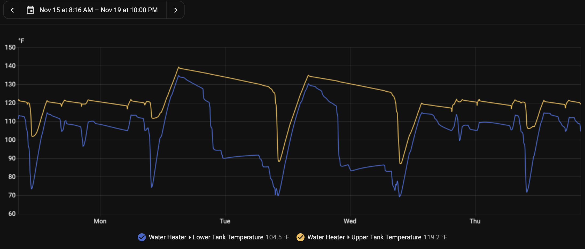

# ♨️ Heat Pump Water Heater Manager

A complete, 24-hour lifecycle management system for Heat Pump Water Heaters (such as Rheem EcoNet, A.O. Smith, or custom ESPHome/Modbus setups) designed to overcome thermal stratification and maximize solar self-consumption.

---

## The Concept: The Water Heater as a Thermal Battery

A 65-gallon Heat Pump Water Heater is more than an appliance—it is a zero-degradation, highly efficient **~3.2 kWh thermal battery**.

Operating at a Coefficient of Performance (COP) around 3.5, superheating the tank from 120°F to 140°F during peak midday solar absorbs over 3 kWh of thermal energy while consuming under 1 kWh of solar electricity. By dropping the setpoint in the evening (ahead of the solar ramp-down), the household avoids running the compressor during peak evening demand hours and prevents draining stationary home battery storage overnight—eliminating chemical battery cycle degradation and round-trip conversion losses.

---

## The Challenge: Stratification & The "False Full" Thermostat

While cycling the tank as a thermal battery is economically ideal, occasional evening water draws (e.g. late showers, baths, or dishwashing) introduce severe **thermal stratification**:
* Cold municipal water enters the bottom of the tank via the dip tube, displacing hot water in the lower ~60% of the volume.
* Hot water floats at the top, keeping the upper tank temperature sensor at or near the 120°F reduced setpoint.
* Because the upper sensor satisfies the thermostat, the heat pump never triggers overnight.
* Without intervention, only a thin layer of hot water remains at the top. When morning showers are taken, that top layer is quickly exhausted, drawing cold water from below—hours before the 10:00 AM daytime solar boost window could ever engage.


*Widening gap between upper and lower tank temperatures following evening water draws.*

---

## The Solution

1. **Early Morning Assurance (06:30 AM default check):** Evaluates the lower tank temperature well before morning showers. If depleted (< 102°F), it calculates a dynamic overdrive setpoint (`upper + 4°F`, up to 140°F) to force the compressor on, runs until the lower tank reaches a safe reserve (112°F), and resets back to baseline—guaranteeing recovery completes before shower time.
2. **Daytime Solar Soak (10:00 AM):** Checks today's solar PV forecast. If high (> 25 kWh), boosts setpoint to 140°F to store free solar energy as thermal storage. If low, maintains a reliable 125°F baseline.
3. **Evening Reset (4:00 PM):** Drops setpoint to 120°F to prevent the compressor from cycling overnight on home battery storage or grid power, treating the water heater as a pre-charged thermal battery.
4. **Native Logbook Integration:** Automatically logs every setpoint change and trigger event to Home Assistant's native Logbook with zero helpers or setup required.
5. **(Optional) True State of Charge (SoC):** Volumetric thermal storage tracking (0–100% nominal SoC + solar boost) and dedicated first-class sensors for usable shower minutes and gallons.
6. **(Optional) Native Dashboard Card:** A complete, glanceable Lovelace card with SoC gauge, operating status, tank temperatures, and live event log.

---

## Files in this Package

| File | Type | Description |
| :--- | :--- | :--- |
| [`blueprint.yaml`](blueprint.yaml) | **Core Automation** | Automation blueprint for the 24-hr manager. Zero helpers or extra sensors required. |
| [`templates.yaml`](templates.yaml) | *Optional Monitoring* | Template sensors for State of Charge (0–100% nominal + solar boost), thermal spread, shower minutes, and gallons. |
| [`hpwh-card.js`](hpwh-card.js) | *Custom UI Card* | Compact Lovelace card with battery dial, glance metrics, and visual GUI dialog. |

---

## Quick Start (Install in Under 1 Minute)

### Step 1: Import and Configure the Blueprint

The automation blueprint requires **zero extra helpers and zero YAML configuration**. It uses your existing water heater climate entity and temperature sensors:

#### Option A: 1-Click Import via My Home Assistant (Recommended)

[](https://my.home-assistant.io/redirect/blueprint_import/?blueprint_url=https%3A%2F%2Fraw.githubusercontent.com%2Fccma14%2Fhomeassistant-toolbox%2Fmain%2Fhpwh%2Fblueprint.yaml)

*Or import manually via URL:*
1. In Home Assistant, go to **Settings > Automations & Scenes > Blueprints**.
2. Click **Import Blueprint** (bottom right).
3. Paste the raw GitHub URL:
   ```text
   https://raw.githubusercontent.com/ccma14/homeassistant-toolbox/main/hpwh/blueprint.yaml
   ```
4. Click **Preview** and then **Import Blueprint**.

#### Option B: Manual File Placement
Copy [`blueprint.yaml`](blueprint.yaml) directly into your Home Assistant configuration directory:
```text
/config/blueprints/automation/hpwh_daily_manager.yaml
```
Then reload blueprints under **Developer Tools > YAML > Automations**.

#### Creating the Automation:
1. In **Settings > Automations & Scenes > Blueprints**, find **Solar & Stratification Heat Pump Water Heater Manager** and click **Create Automation**.
2. Select your entities:
   * **Water Heater Climate Entity:** `climate.water_heater` (or your water heater entity)
   * **Lower Tank Temperature Sensor:** `sensor.water_heater_lower_tank_temperature`
   * **Upper Tank Temperature Sensor:** `sensor.water_heater_upper_tank_temperature`
   * **Solar Forecast Sensor:** `sensor.solar_forecast_today` (e.g. Solcast, Forecast.Solar)
3. Click **Save**. **You're done!** Your water heater will now automatically manage morning recovery, daytime solar soak, and evening reset. Every action is logged to your water heater's native Logbook.

---

## Optional: Visual Monitoring & Dashboard

If you'd like a visual dashboard with a thermal battery gauge, stratification spread, shower minutes, and gallon estimates:

### Step 2: Install the State of Charge (SoC) Sensor

The SoC sensor computes true tank thermal reserves using a 40% upper / 60% lower volumetric weighting:

#### If your `configuration.yaml` uses `template: !include templates.yaml`:
Open your `templates.yaml` and paste the contents of [`templates.yaml`](templates.yaml) (starting from the `- sensor:` line). If your sensor names differ from the defaults, simply find & replace them.

#### Reloading:
Navigate to **Developer Tools > YAML** and click **Template Entities**. The sensor `sensor.water_heater_state_of_charge` will become active immediately without a restart.

---

### Step 3: Add the Dashboard Card

<p align="center">
  
</p>

The package includes a dedicated, ultra-compact Lovelace card featuring an SVG battery dial, glance metrics (supporting both **Shower Minutes** and **Gallons**), manual boost/reset actions, and a **100% visual GUI configuration dialog**.

#### 1. Install the Card:
1. Download [`hpwh-card.js`](https://raw.githubusercontent.com/ccma14/homeassistant-toolbox/main/hpwh/hpwh-card.js) into your Home Assistant directory at `/config/www/hpwh-card.js`:
   ```bash
   wget -O /config/www/hpwh-card.js https://raw.githubusercontent.com/ccma14/homeassistant-toolbox/main/hpwh/hpwh-card.js
   ```
2. In Home Assistant, open the **Dashboard Resources** page:

   [](https://my.home-assistant.io/redirect/lovelace_resources/)

   *(Or navigate to **Settings > Dashboards > 3 dots (top right) > Resources**, or open `/config/lovelace/resources` directly on your server. Note: Ensure **Advanced Mode** is toggled ON under your user profile for this menu to be visible).*
3. Click **+ Add Resource** (bottom right):
   * **URL:** `/local/hpwh-card.js`
   * **Resource type:** `JavaScript Module`
4. Refresh your browser window.

#### 2. Add to Dashboard:
1. Open your dashboard and click **Edit Dashboard** $\rightarrow$ **+ Add Card**.
2. Search for **Heat Pump Water Heater Card** (or select it from the card picker).
3. Select your entities using the visual dropdown pickers (**Water Heater**, **Power Sensor**, **SoC Sensor**, **Tank Temperatures**)—**no YAML editing required!**
4. All metrics (SoC dial, Status, Target, and Temperatures) are **clickable** to view native Home Assistant history and graphs.

*(For users who manage dashboards in YAML mode, you can also add it directly with `type: custom:hpwh-card` and `entity: climate.water_heater`.)*

---

## Safety & System Requirements
* **Thermostatic Mixing Valve:** A thermostatic tempering valve installed at the water heater outlet is **strongly recommended** when boosting storage to 140°F. This protects plumbing fixtures and prevents scald risk while giving you the full benefit of thermal energy storage.
* **Integrations Supported:** Any integration providing standard Home Assistant climate controls and temperature sensors (e.g. Rheem EcoNet via ESPHome, native cloud EcoNet, A.O. Smith, Stiebel Eltron, or Modbus).
