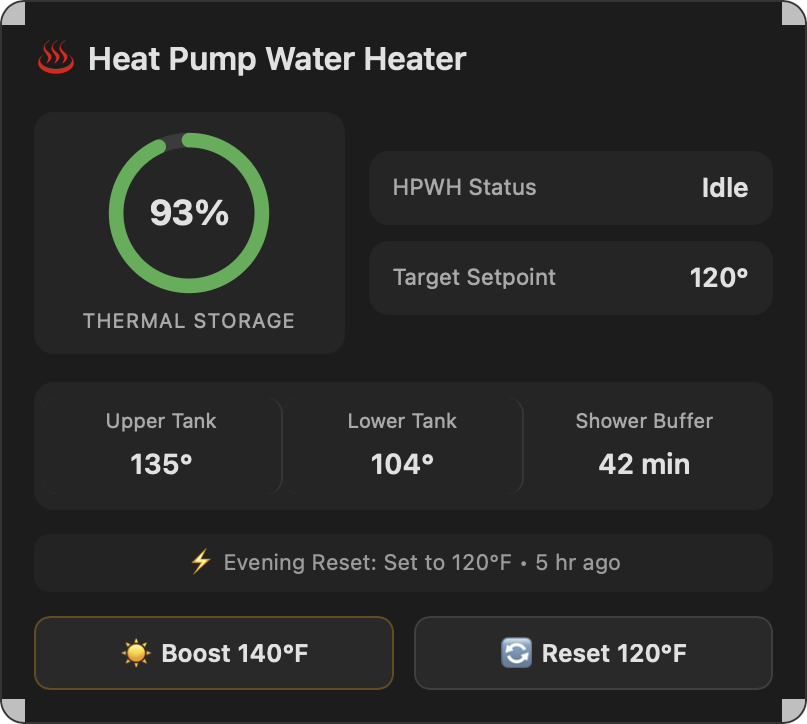

# ♨️ Heat Pump Water Heater Manager

A Home Assistant automation blueprint and dashboard card for Heat Pump Water Heaters (such as Rheem EcoNet via ESPHome) to manage tank stratification and maximize daytime solar self-consumption.

---

## The Concept: The Water Heater as a Thermal Battery

A 65-gallon Heat Pump Water Heater is a zero-degradation thermal battery capable of storing **nearly 12 kWh of thermal energy**—rivaling the usable capacity of a residential home chemical battery.

Operating at an advertised Coefficient of Performance (COP) up to 4.0 (according to Rheem), banking that energy requires under 3.0 kWh of solar electricity, while a 140°F midday boost adds ~3.2 kWh of thermal storage. Boosting during peak solar hours and dropping the setpoint ahead of evening solar ramp-down allows the home to run through peak hours and overnight on stored heat—avoiding draining home battery reserves overnight while bypassing round-trip conversion losses.

---

## The Challenge: Stratification & The "False Full" Thermostat

Using the tank as a thermal battery works well, but evening water draws (such as showers, baths, or dishwashing) cause **thermal stratification**:
* Cold municipal water enters the bottom of the tank, displacing hot water in the lower ~60% of the volume.
* Hot water floats at the top, keeping the upper temperature sensor at or near the 120°F reduced setpoint.
* Because the upper sensor satisfies the thermostat, the heat pump does not turn on overnight.
* In the morning, only a thin layer of hot water remains. That hot layer is quickly exhausted during early showers, drawing cold water up from the bottom well before the daytime solar window begins.


*Widening gap between upper and lower tank temperatures following evening water draws.*

---

## The Solution

1. **Early Morning Check (04:30 AM default):** Checks the lower tank temperature before morning showers. If depleted (< 102°F), it raises the setpoint slightly above the upper sensor (`upper + 4°F`, up to 140°F) to turn on the compressor, runs until the lower tank reaches a safe reserve (112°F), and resets back to baseline.
2. **Daytime Solar Boost (10:00 AM):** Checks today's solar PV forecast. If sunny (> 25 kWh forecast), boosts the setpoint to 140°F to store solar energy as hot water. If cloudy, maintains a 125°F baseline.
3. **Evening Reset (4:00 PM):** Drops the setpoint to 120°F ahead of sunset to prevent the compressor from running overnight on battery storage or grid power.
4. **Logbook Integration:** Automatically logs every setpoint change and trigger event to Home Assistant's native Logbook.
5. **(Optional) State of Charge (SoC):** Volumetric thermal storage tracking (0–100% nominal SoC + solar boost) and sensors for usable shower minutes and gallons.
6. **(Optional) Dashboard Card:** A Lovelace card with an SoC gauge, operating status, tank temperatures, and recent events.

---

## Files in this Package

| File | Type | Description |
| :--- | :--- | :--- |
| [`blueprint.yaml`](blueprint.yaml) | **Automation Blueprint** | Daily schedule and stratification manager. |
| [`hpwh.yaml`](hpwh.yaml) | *Sensors Package* | Template sensors for State of Charge (0–100% + solar boost), shower minutes, and gallons. |
| [`hpwh-card.js`](hpwh-card.js) | *Custom UI Card* | Lovelace card with battery gauge, metrics, and card editor. |

---

## Setup

### Step 1: Import and Configure the Blueprint

Import the blueprint using either method below:

#### Option A: 1-Click Import via My Home Assistant (Recommended)

[](https://my.home-assistant.io/redirect/blueprint_import/?blueprint_url=https%3A%2F%2Fraw.githubusercontent.com%2Fccma14%2Fhomeassistant-toolbox%2Fmain%2Fhpwh%2Fblueprint.yaml)

*Or import manually via URL:*
1. In Home Assistant, go to **Settings > Automations & Scenes > Blueprints**.
2. Click **Import Blueprint** (bottom right).
3. Paste the raw GitHub URL:
   ```text
   https://raw.githubusercontent.com/ccma14/homeassistant-toolbox/main/hpwh/blueprint.yaml
   ```
4. Click **Preview** and then **Import Blueprint**.

#### Option B: Manual File Placement
Copy [`blueprint.yaml`](blueprint.yaml) directly into your Home Assistant configuration directory:
```text
/config/blueprints/automation/hpwh_daily_manager.yaml
```
Then reload blueprints under **Developer Tools > YAML > Automations** (or **Settings > Developer Tools / Tools > YAML > Automations**).

#### Creating the Automation:
1. In **Settings > Automations & Scenes > Blueprints**, find **Solar & Stratification Heat Pump Water Heater Manager** and click **Create Automation**.
2. Select your entities:
   * **Water Heater Climate Entity:** `climate.water_heater` (or your water heater entity)
   * **Lower Tank Temperature Sensor:** `sensor.water_heater_lower_tank_temperature`
   * **Upper Tank Temperature Sensor:** `sensor.water_heater_upper_tank_temperature`
   * **Solar Forecast Sensor:** `sensor.solar_forecast_today` (e.g. Solcast, Forecast.Solar)
3. Click **Save**. The automation will now manage morning recovery, solar boost, and evening reset. Every action is logged to your water heater's native Logbook.

---

## Optional: Visual Monitoring & Dashboard Card

<p align="center">
  
</p>

To install the dashboard card, State of Charge (SoC) gauge, and usable shower metrics (minutes/gallons), follow the steps below:

> [!TIP]
> **Configuration Directory Paths:** In Home Assistant OS (e.g. inside the **File Editor** or **Studio Code Server** add-ons), the configuration root directory is displayed as `/homeassistant/`. In container/core installations or SSH terminals, it is traditionally `/config/`. Both refer to the same folder where `configuration.yaml` resides.

### Step 1: Install the Sensor Package
Packages provide self-contained, drop-in YAML with zero indentation errors or manual editing of `configuration.yaml`.

1. Ensure packages are enabled in your `configuration.yaml` (add under `homeassistant:` if not already present):
   ```yaml
   homeassistant:
     packages: !include_dir_named packages
   ```
2. Download or copy [`hpwh.yaml`](hpwh.yaml) into your `packages/` folder (e.g. `/config/packages/hpwh.yaml` or `/homeassistant/packages/hpwh.yaml`):
   ```bash
   wget -O /config/packages/hpwh.yaml https://raw.githubusercontent.com/ccma14/homeassistant-toolbox/main/hpwh/hpwh.yaml
   ```
   *(If using the File Editor UI: create a `packages` folder next to `configuration.yaml`, create `hpwh.yaml` inside it, and paste the file contents).*
3. **Customize Entity IDs & Tank Size (if needed):**
   Open `packages/hpwh.yaml`:
   * **Sensor Entity IDs:** If your water heater sensors differ from `sensor.water_heater_upper_tank_temperature` and `sensor.water_heater_lower_tank_temperature`, use Find & Replace to swap them with your actual entity IDs.
   * **Inlet Temperature & Tank Capacity:** Under `sensor.water_heater_inlet_temperature`, adjust `inlet_cfg` (default `65.0`°F, or an entity ID like `'sensor.water_inlet_temperature'`). Under `sensor.water_heater_state_of_charge`, adjust `tank_cfg` (default `65.0` gal). Downstream shower metrics inherit these automatically.
4. Reload template entities under **Developer Tools / Tools > YAML > Template Entities** (or restart Home Assistant).

### Step 2: Install the Dashboard Card
1. Download [`hpwh-card.js`](hpwh-card.js) into your `www/` directory (e.g. `/config/www/hpwh-card.js` or `/homeassistant/www/hpwh-card.js`):
   ```bash
   wget -O /config/www/hpwh-card.js https://raw.githubusercontent.com/ccma14/homeassistant-toolbox/main/hpwh/hpwh-card.js
   ```
   *(Note: The `/www/` folder inside your config directory maps to the `/local/` URL in Home Assistant).*
2. In Home Assistant, open the **Dashboard Resources** page:

   [](https://my.home-assistant.io/redirect/lovelace_resources/)

   *(Or navigate to **Settings > Dashboards > 3 dots (top right) > Resources**, or open `/config/lovelace/resources` directly on your server. Note: Ensure **Advanced Mode** is toggled ON under your user profile for this menu to be visible).*
3. Click **+ Add Resource** (bottom right):
   * **URL:** `/local/hpwh-card.js?v=1.2.0`
   * **Resource type:** `JavaScript Module`
4. Refresh your browser window.

---

### Step 3: Add the Card to Your Dashboard

1. Open your dashboard and click **Edit Dashboard** $\rightarrow$ **+ Add Card**.
2. Search for **Heat Pump Water Heater Card** (or select it from the card picker).
3. Select your entities in the card editor (**Water Heater**, **Power Sensor**, **SoC Sensor**, **Tank Temperatures**).
4. All metrics (SoC dial, Status, Target, and Temperatures) are **clickable** to view native Home Assistant history and graphs.

*(For users who manage dashboards in YAML mode, you can also add it directly with `type: custom:hpwh-card` and `entity: climate.water_heater`.)*

---

## Safety & System Requirements
* **Operating Mode (Heat Pump Only Recommended):** The automation works across any operating mode (Heat Pump, Hybrid/Energy Saver, or Electric). However, we strongly recommend setting your water heater to **Heat Pump mode** via your integration (e.g. `esphome-econet`). In Hybrid or Energy Saver modes, a large setpoint jump (such as the 140°F solar boost) may trigger the water heater's internal logic to engage the high-draw electric resistance elements rather than heating efficiently with just the compressor.
* **Temperature Scale & Units:** All blueprint setpoints, stratification thresholds, and template sensor calculations are calibrated for **Fahrenheit (°F)** and US gallons.
* **Thermostatic Mixing Valve:** A thermostatic tempering valve installed at the water heater outlet is **strongly recommended** when boosting storage to 140°F. This protects plumbing fixtures and prevents scald risk while giving you the full benefit of thermal energy storage.
* **Dual Tank Temperature Sensors Required:** Stratification detection and morning assurance rely on having both upper and lower tank temperature measurements.
  * **Rheem EcoNet Water Heaters (Recommended):** The official Home Assistant cloud EcoNet integration only exposes a single aggregated temperature. To expose both built-in sensors, use the open-source [**`esphome-econet`**](https://github.com/esphome-econet/esphome-econet) project, which connects directly to the water heater's internal serial bus to provide 100% local control with discrete upper and lower temperature sensors (`sensor.water_heater_upper_tank_temperature` and `sensor.water_heater_lower_tank_temperature`).
  * **Other Equipment / External Probes:** You can experiment with external temperature sensors (e.g. 1-Wire DS18B20 probes placed under the upper and lower service panels), though surface readings will have more thermal lag than built-in sensors.
