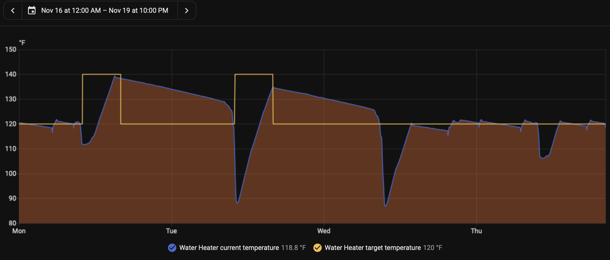

# ♨️ Heat Pump Water Heater Manager

A complete, 24-hour lifecycle management system for Heat Pump Water Heaters (such as Rheem EcoNet, A.O. Smith, or custom ESPHome/Modbus setups) designed to overcome thermal stratification and maximize solar self-consumption.

---

## The Challenge

Heat pump water heaters suffer from severe **thermal stratification** after evening showers:
* Incoming cold water enters the bottom of the tank via the dip tube.
* Hot water rises and floats at the top.
* Because the upper tank temperature sensor remains near setpoint, the heat pump's internal thermostat never triggers overnight.
* On a subsequent low-solar or cloudy day without an early solar boost, morning showers can run lukewarm or cold.


*Figure 1: Widening gap between upper and lower tank temperatures following evening water draws.*


*Figure 2: Heat pump setpoint remains static while the lower tank drops into depleted temperatures.*

---

## The Solution

1. **Early Morning Assurance (06:30 AM):** Evaluates the lower tank temperature. If depleted (< 102°F), it calculates a dynamic overdrive setpoint (`upper + 4°F`, up to 140°F) to force the compressor on, runs until the lower tank reaches a safe reserve (112°F), and resets back to baseline.
2. **Daytime Solar Soak (10:00 AM):** Checks today's solar PV forecast. If high (> 25 kWh), boosts setpoint to 140°F to store free solar thermal energy. If low, maintains a reliable 125°F baseline.
3. **Evening Reset (16:00 PM):** Drops setpoint to 120°F to prevent compressor cycling on expensive evening/overnight grid power.
4. **Native Logbook Integration:** Automatically logs every setpoint change and trigger event to Home Assistant's native Logbook with zero helpers or setup required.
5. **(Optional) True State of Charge (SoC):** A 40/60 volumetric weighted thermal storage sensor that tracks real usable energy and estimated shower gallons.
6. **(Optional) Native Dashboard Card:** A complete, glanceable Lovelace card with SoC gauge, operating status, tank temperatures, and live event log.

---

## Files in this Package

| File | Type | Description |
| :--- | :--- | :--- |
| [`blueprint.yaml`](blueprint.yaml) | **Core Automation** | Automation blueprint for the 24-hr manager. Zero helpers or extra sensors required. |
| [`templates.yaml`](templates.yaml) | *Optional Monitoring* | Template sensor computing State of Charge (0–135%), thermal spread, and shower gallons. |
| [`dashboard.yaml`](dashboard.yaml) | *Optional UI Card* | Lovelace YAML card configuration using standard Home Assistant UI elements. |

---

## Quick Start (Install in Under 1 Minute)

### Step 1: Import and Configure the Blueprint

The automation blueprint requires **zero extra helpers and zero YAML configuration**. It uses your existing water heater climate entity and temperature sensors:

#### Option A: Direct Import via GitHub URL (Recommended)
1. In Home Assistant, go to **Settings > Automations & Scenes > Blueprints**.
2. Click **Import Blueprint** (bottom right).
3. Paste the raw GitHub URL for [`blueprint.yaml`](https://raw.githubusercontent.com/ccma14/homeassistant-toolbox/main/hpwh/blueprint.yaml).
4. Click **Preview** and then **Import Blueprint**.

#### Option B: Manual File Placement
Copy [`blueprint.yaml`](blueprint.yaml) directly into your Home Assistant configuration directory:
```text
/config/blueprints/automation/hpwh_daily_manager.yaml
```
Then reload blueprints under **Developer Tools > YAML > Automations**.

#### Creating the Automation:
1. In **Settings > Automations & Scenes > Blueprints**, find **Solar & Stratification Heat Pump Water Heater Manager** and click **Create Automation**.
2. Select your entities:
   * **Water Heater Climate Entity:** `climate.water_heater_econet_hpwh`
   * **Lower Tank Temperature Sensor:** `sensor.water_heater_lower_tank_temperature`
   * **Upper Tank Temperature Sensor:** `sensor.water_heater_upper_tank_temperature`
   * **Solar Forecast Sensor:** `sensor.solcast_pv_forecast_forecast_today`
3. Click **Save**. **You're done!** Your water heater will now automatically manage morning recovery, daytime solar soak, and evening reset. Every action is logged to your water heater's native Logbook.

---

## Optional: Visual Monitoring & Dashboard

If you'd like a visual dashboard with a thermal battery gauge, stratification spread, and shower gallon estimates:

### Step 2: Install the State of Charge (SoC) Sensor

The SoC sensor computes true tank thermal reserves using a 40% upper / 60% lower volumetric weighting:

#### If your `configuration.yaml` uses `template: !include templates.yaml`:
Open your `templates.yaml` and paste the contents of [`templates.yaml`](templates.yaml) (starting from the `- sensor:` line):
```yaml
- sensor:
    - name: "Water Heater State of Charge"
      unique_id: water_heater_state_of_charge
      unit_of_measurement: "%"
      state_class: measurement
      icon: mdi:battery-charging-high
      state: >-
        
        
        
        
        
        
        {{ [ [ soc | round(1), 0 ] | max, 135 ] | min }}
      attributes:
        upper_temperature: >-
          {{ states('sensor.water_heater_upper_tank_temperature') | float(0) }}
        lower_temperature: >-
          {{ states('sensor.water_heater_lower_tank_temperature') | float(0) }}
        average_temperature: >-
          
          
          {{ ((upper * 0.4) + (lower * 0.6)) | round(1) }}
        tank_spread: >-
          
          
          {{ (upper - lower) | round(1) }}
        usable_shower_gallons_est: >-
          
          
          
          
          
          
            
            
            {{ [gal_at_105 | round(0), 0] | max }}
          
            0
          
```

#### Reloading:
Navigate to **Developer Tools > YAML** and click **Template Entities**. The sensor `sensor.water_heater_state_of_charge` will become active immediately without a restart.

---

### Step 3: Add the Dashboard Card

The dashboard card uses standard, native Home Assistant UI components (no HACS required):

1. Open your Home Assistant dashboard.
2. Click the **three dots** in the top-right corner and select **Edit Dashboard**.
3. Click **+ Add Card** at the bottom right.
4. Scroll to the bottom of the card list and select **Manual**.
5. Paste the complete YAML from [`dashboard.yaml`](dashboard.yaml).
6. Click **Save** and then **Done**.

---

## Safety & System Requirements
* **Thermostatic Mixing Valve:** A thermostatic tempering valve installed at the water heater outlet is **strongly recommended** when boosting storage to 140°F. This protects plumbing fixtures and prevents scald risk while giving you the full benefit of thermal energy storage.
* **Integrations Supported:** Any integration providing standard Home Assistant climate controls and temperature sensors (e.g. Rheem EcoNet via ESPHome, native cloud EcoNet, A.O. Smith, Stiebel Eltron, or Modbus).
